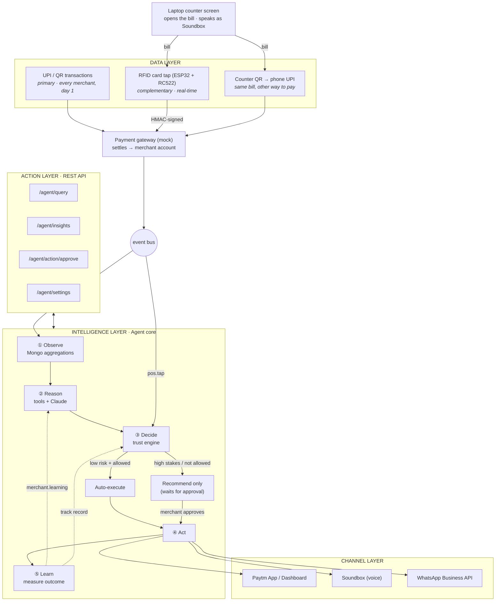

# Vyapaar Mitra Agent

**The AI business copilot for every Paytm merchant — shipped as an API, not another app.**
Track 1 · Merchant Growth AI

Vyapaar Mitra watches a merchant's payments in the background and runs a closed loop — **Observe → Reason → Decide → Act → Learn**. It notices a slow Tuesday and sends regulars a WhatsApp offer, spots loyal customers who stopped coming and invites them back, surfaces a pre-qualified loan when settlements are steady, and — where a POS/RFID terminal exists — tells the merchant *"yeh regular customer hain"* while the customer is still at the counter.

- **Works from day 1 on UPI/QR data alone.** POS/RFID is a complementary, real-time signal, not a requirement.
- **The merchant sets the rules.** Low-risk actions (marketing) may auto-execute; high-stakes ones (credit) are always recommend-only — enforced in code, not configuration.
- **Explainable.** Every decision is stored with its evidence and the trust-engine trace that allowed or blocked it.
- **Runs offline.** Without a Claude API key or channel credentials it falls back to rule-based reasoning and mock channels, so the full flow still works.
- **Card or QR at the counter.** The laptop opens a bill; the customer taps an RFID card on the ESP32 reader *or* scans the QR with their phone. The laptop is the Soundbox — it speaks *"₹240 prapt hue"* and the agent's nudges out loud.

---

## Contents

1. [Architecture](#1-architecture)
2. [How the code maps to the architecture](#2-how-the-code-maps-to-the-architecture)
3. [Quick start](#3-quick-start)
4. [Environment variables](#4-environment-variables)
5. [The demo, step by step](#5-the-demo-step-by-step)
6. [API reference](#6-api-reference)
7. [Inside the agent loop](#7-inside-the-agent-loop)
8. [Data model (MongoDB)](#8-data-model-mongodb)
9. [Hardware — ESP32 POS/RFID terminal](#9-hardware--esp32-posrfid-terminal)
10. [Security & privacy](#10-security--privacy)
11. [Going to production](#11-going-to-production)
12. [Troubleshooting](#12-troubleshooting)

---

## 1. Architecture



**Two paths through the same agent:**

| Path | Trigger | Flow |
|---|---|---|
| **Scheduled cycle** | every 30 min (cron) or `POST /agent/run` | Observe → Reason → Decide → Act → Learn over the last 28 days |
| **Real-time** | card tap or counter QR payment (`pos.tap` event) | "₹240 prapt hue" → recognise customer → Decide → Act (Soundbox nudge) in < 1 s |
| **Daily briefing** | 9:00 AM (cron) or `POST /agent/briefing` | spoken summary on the Soundbox |

---

## 2. How the code maps to the architecture

```
vyapaar-mitra-agent/
├── src/
│   ├── routes/payments.js        DATA LAYER in    POST /payments/upi (primary) · POST /pos/tap (complementary)
│   ├── routes/counter.js            counter     POST /checkout (laptop) · POST /pos/card (ESP32) · POST /pay/:id (phone QR)
│   ├── services/checkoutService.js  counter     one open bill, paid by card OR QR, never twice
│   ├── routes/live.js               live feed   Server-Sent Events → laptop screen (Soundbox voice, payments, agent)
│   ├── services/paymentGateway.js   gateway     settle → merchant account, emit to event bus
│   ├── services/customerService.js  identity    hashed UPI/RFID → one customer profile, segments
│   ├── events/bus.js                 bus        transaction.settled · pos.tap  (swap for Kafka later)
│   │
│   ├── agent/                     INTELLIGENCE LAYER
│   │   ├── observe.js            ① Observe      timezone-aware MongoDB aggregations → snapshot
│   │   ├── tools/                   tool layer  deterministic analytics (own the FACTS)
│   │   │   ├── salesTrend.js          analyze_sales_trend()    recurring weekday dip, week-over-week
│   │   │   ├── dormantCustomers.js    find_dormant_regulars()
│   │   │   ├── creditEligibility.js   flag_credit_opportunity() (indicative, recommend-only)
│   │   │   ├── slowMovers.js          suggest_restock()
│   │   │   └── realtimeRecognition.js recognize_customer()     POS signal
│   │   ├── reason.js             ② Reason       Claude ranks + explains findings (own the WORDS), guardrailed
│   │   ├── llm.js                   Claude API  wrapper with offline fallback
│   │   ├── decide.js             ③ Decide       trust engine (owns PERMISSION) — pure function
│   │   ├── act.js                ④ Act          execute via channels or queue for approval
│   │   ├── learn.js              ⑤ Learn        measure outcomes → merchant.learning
│   │   └── index.js                 loop        runCycle · onPosTap · dailyBriefing · query
│   │
│   ├── routes/agent.js            ACTION LAYER    /agent/query · /insights · /actions · /action/approve · /settings · /run · /briefing
│   ├── channels/                  CHANNEL LAYER   soundbox.js · whatsapp.js · dashboard.js (live or mock)
│   ├── models/                    MongoDB         Merchant · Transaction · CustomerProfile · AgentInsight · AgentAction · ChannelMessage
│   ├── middleware/                auth            x-api-key (merchant API) · HMAC device signatures (POS)
│   ├── jobs/scheduler.js          background     agent cycle + daily briefing (node-cron)
│   ├── app.js / server.js         bootstrap
│   └── config/                    env + db
├── public/
│   ├── counter.html               laptop screen: bill + QR, Soundbox voice, agent feed, approvals, ask
│   └── pay.html                   phone page opened by the QR (demo UPI checkout)
├── hardware/                      ESP32/ESP8266 + RC522 card reader (firmware, wiring)
├── scripts/
│   ├── seed.js                    28 days of demo data for "Ramesh General Store"
│   ├── simulate.js                the whole architecture end-to-end in one command
│   └── virtualPos.js              software twin of the ESP32 terminal
└── test/                          node:test — tools, trust engine, security
```

**Design rule:** *tools own the facts, the LLM owns the words, the trust engine owns permission.* Claude can re-rank findings and write the copy, but it cannot invent a finding, a number or a new kind of action, and it can move a tool's confidence by at most ±0.2.

---

## 3. Quick start

**Prerequisites:** Node.js **20+** and MongoDB (local, Docker, or free Atlas cluster).

```bash
# 1. Install
npm install

# 2. MongoDB — pick one
docker compose up -d                         # local Mongo on 27017
#   or create a free cluster at https://www.mongodb.com/atlas and copy its URI

# 3. Configure
cp .env.example .env
#   set MONGODB_URI, API_KEY, IDENTITY_PEPPER
#   optional: ANTHROPIC_API_KEY (Claude), WhatsApp + Soundbox credentials
npm run gen:device-secret                    # paste into POS_DEVICE_SECRETS=POS-RAMESH-01:<secret>

# 4. Test (no database needed)
npm test

# 5. See the whole thing work
npm run simulate                             # re-seeds, boots the API in-process, runs the story

# 6. Or run it as a service
npm run seed                                 # demo merchant + 28 days of payments
npm run dev                                  # API on :4000 + background agent + 9 AM briefing
# 7. Build the React merchant app once (frontend/), then open it
npm run app:install && npm run app:build
#    http://localhost:4000/          → sign in with any 10-digit mobile + any 6-digit OTP (not 000000)
#    (the older one-page counter is still at http://localhost:4000/counter)
```

Check it's alive: `curl localhost:4000/api/v1/health`

### The React merchant app (`frontend/`)

The app (React 19 + Vite + Tailwind, 4 languages) is wired to this backend through **`/api/app`** — a layer that serves exactly the JSON the app's typed client expects (`frontend/src/lib/api.ts`, contract in `frontend/src/mocks/types.ts`), built from the real agent data.

| Run it as | Command | URL |
|---|---|---|
| Production-style (one server) | `npm run app:build` then `npm run dev` | `http://localhost:4000/` |
| Live-reload while editing the UI | `npm run dev` **and** `npm run app:dev` (2 terminals) | `http://localhost:5173/` (Vite proxies `/api` → :4000) |
| UI only, no backend | set `VITE_API_BASE_URL=` (empty) in `frontend/.env` | in-browser mock data |

What's live in the app:

| Screen / feature | Backed by |
|---|---|
| OTP sign-in | `POST /api/app/auth/otp`, `/auth/verify` → signed session token (demo: any OTP except 000000) |
| Counter: new bill → **real scannable QR** + "Tap card" | Checkout service. QR opens `/pay/:id` on the customer's phone |
| Payment lands on screen when the **ESP32 card** is tapped or the **phone pays by QR** | Live feed `GET /api/app/live` (Server-Sent Events) |
| Soundbox voice: payment + the agent's nudge ("19vi baar aaye hain…") | Same live feed; the browser speaks it |
| **Card scanned** panel: link a new physical card to Sharma ji / Gupta ji | `POST /api/app/counter/card/link` |
| "Tap card" button with no hardware | Simulator: taps Sharma ji, Gupta ji, then a new card in turn, same code path as the ESP32 |
| Today's sales, recent payments | `GET /api/app/counter/today` (real transactions) |
| Dip insight, morning briefing | `GET /api/app/agent/insights` (Observe snapshot + agent insights + live cash forecast) |
| Approvals: approve / reject / **pause / resume / undo** (undo window) | `POST /api/app/agent/action/approve` |
| Run agent now (Observe → Learn) + today's pace vs a usual day | `POST /api/app/agent/run` |
| Trust settings: Auto / Ask / Off, spend cap, undo window (loan locked) | `GET/PUT /api/app/agent/settings/trust` |
| Reorder suggestion (sugar + oil running low, costed) | New `findLowStock` tool + shelf stock in `merchant.inventory` |
| 14-day cash forecast + "cash may run short in N days" | New `forecastCashflow` tool |
| Campaigns funnel (sent → redeemed, extra sales) | Real WhatsApp sends + who actually came back and spent |
| Regulars (masked, loyalty reward every 12th visit, WhatsApp consent) | Customer profiles |
| Impact (week vs week, what the agent learned) | Learn step outcomes + `merchant.learning` |
| Ask Mitra (with a number card or 7-day bar chart) | `POST /api/app/agent/query` (Claude or rule-based) |

`npm run seed` now also runs one agent cycle, so the app opens with insights, an auto-sent offer and approvals waiting.

---

## 4. Environment variables

All variables are documented in [`.env.example`](.env.example). The important ones:

| Variable | Required | Purpose |
|---|---|---|
| `MONGODB_URI` | ✅ | local `mongodb://127.0.0.1:27017/vyapaar_mitra` or Atlas `mongodb+srv://…` |
| `API_KEY` | ✅ | shared key for the merchant-facing API (`x-api-key` header) |
| `IDENTITY_PEPPER` | ✅ | secret used to hash UPI IDs / card UIDs — **changing it breaks customer history** |
| `POS_DEVICE_SECRETS` | for POS | `deviceId:secret` pairs; same secret goes in the ESP32 `config.h` |
| `ANTHROPIC_API_KEY` | optional | enables Claude for ranking, copy, briefings and `/agent/query`; empty = rule-based |
| `ANTHROPIC_MODEL` | optional | default `claude-sonnet-5-5` |
| `AGENT_CYCLE_CRON` / `DAILY_BRIEFING_CRON` | optional | default every 30 min / 9:00 AM |
| `TZ` | optional | business-day maths time zone, default `Asia/Kolkata` |
| `REGULAR_VISIT_THRESHOLD` / `DORMANT_AFTER_DAYS` | optional | who counts as a regular / as lapsed (5 visits / 14 days) |
| `SOUNDBOX_WEBHOOK_URL` | optional | where spoken text is POSTed; empty = logged (mock) |
| `WHATSAPP_PHONE_NUMBER_ID` / `WHATSAPP_ACCESS_TOKEN` | optional | Meta WhatsApp Cloud API; empty = mock |
| `DASHBOARD_WEBHOOK_URL` | optional | push insights/approvals to any app; otherwise pull via `/agent/insights` |

In **mock mode** nothing is sent anywhere — every Soundbox line, WhatsApp message and dashboard event is written to the `channelmessages` collection and the console, so you can show exactly what would have been delivered.

---

## 5. The demo, step by step

### A. Live at the table — laptop + RFID reader + a phone

After `npm run seed` and `npm run dev`, open **http://localhost:4000/counter** and click **Enable voice**. First time only: tap each physical card with no bill open and link it to *Sharma ji* / *Gupta ji* (buttons appear on screen) — see [hardware/README.md](hardware/README.md).

| You do | Laptop shows / says |
|---|---|
| Type `240` → **Create bill** | QR code + "tap card" |
| Customer taps card #1 | ✓ ₹240 · `REGULAR · visit #19` · 🔊 *"₹240 prapt hue, card se"* → *"Yeh regular customer hain, 19vi baar aaye hain — 10% loyalty discount dijiye"* |
| New bill `310` → customer scans QR on phone, picks `gupta.ji@okaxis`, **Pay** | ✓ ₹310 via UPI · 🔊 *"₹310 prapt hue, UPI se"* → *"Purane regular customer 20 din baad wapas aaye hain — welcome back"* |
| **Morning briefing** | 🔊 yesterday's sales vs last week, top seller |
| **Run agent now** | feed: Tuesday-dip WhatsApp offer to 40 regulars (auto), win-back to 8 lapsed regulars (auto); approvals: ₹50,000 loan offer + restock tip |
| Approve / reject | the action executes or is dismissed — logged in the audit trail |
| Ask *"Is hafte sabse zyada kya bika?"* | answer from the merchant's own data |

The QR path shows the key point: **recognition works from UPI alone** — the card reader just makes it instant at the counter.

### B. Scripted — `npm run simulate`


Seeds **Ramesh General Store, Mumbai** and replays the deck's story over real HTTP (no laptop screen needed):

| Step | What happens | Layer |
|---|---|---|
| 1 | A customer pays ₹186 by UPI → settled, profile updated | Data → gateway |
| 2 | Soundbox: *"Good morning Ramesh ji. Kal ki sale ₹10,632 thi…"* | Agent → Soundbox |
| 3 | Agent cycle finds: **Tuesday sales ~17% below other days**, **8 lapsed regulars**, **₹50,000 indicative loan**, **detergent slowing** | Observe → Reason |
| 3 | Trust engine: WhatsApp offer → **AUTO** (40 regulars), win-back → **AUTO** (8), loan → **RECOMMEND** (hard lock), restock → **RECOMMEND** (merchant setting) | Decide → Act |
| 4 | App shows insights + two items awaiting approval | `GET /agent/insights` |
| 5 | Merchant approves the loan offer, rejects the restock tip | `POST /agent/action/approve` |
| 6 | Sharma ji taps his card → LCD `REGULAR #19` → Soundbox: *"Yeh regular customer hain, 19vi baar aaye hain — 10% loyalty discount dijiye"* | POS → real-time |
| 7 | Gupta ji (hasn't come in 3 weeks) taps → *"Purane regular customer … wapas aaye hain — welcome back"* | POS → real-time |
| 8 | *"Is hafte sabse zyada kya bika?"* → answered from the merchant's own data | `POST /agent/query` |
| 9 | ⏩ One week later: Tuesday ₹8,6xx → ₹10,900 (**~+26%**), win-back return rate 37.5% → both marked *positive* in `merchant.learning` | Learn |
| 10 | The audit trail shows every rule that let the offer auto-send | `GET /agent/actions` |

Built-in patterns in the seed data are *not* hard-coded answers — the tools discover them from 1,600+ raw transactions. Exact figures shift slightly with the date you run it, because the 28-day window moves.

---

## 6. API reference

Base URL `http://localhost:4000/api/v1`. Merchant endpoints need `x-api-key: <API_KEY>`.

```bash
export API=http://localhost:4000/api/v1 KEY=<your API_KEY> MID=MID-RAMESH-001
```

### Data layer

**`POST /payments/upi`** — primary stream (in production: the gateway's settlement webhook)
```bash
curl -X POST $API/payments/upi -H "x-api-key: $KEY" -H "content-type: application/json" \
  -d '{"merchantId":"'$MID'","amount":186,"payerVpa":"regular7@paytm","items":[{"name":"Chai patti 250g","qty":1,"price":120}]}'
# → {"txnId":"UPI…","amount":186,"channel":"UPI","status":"SETTLED","payer":"re***@paytm","customer":{"visitCount":17,"segment":"regular"}}
```

**`POST /pos/tap`** — complementary stream, from the ESP32 (HMAC-signed, see §10). Use `npm run pos:tap -- A3F19C2B 240` to send one without hardware.
```json
← {"ok":true,"txnId":"POS…","amount":240,"visit":19,"tag":"REGULAR"}
```

**`POST /pos/card`** — the ESP32 reader (HMAC-signed). Body is only `{"rfidUid":"A3F19C2B"}`; it pays the bill open on the counter. `409` = no bill open (the card is then shown on the counter screen for linking). Try without hardware: `npm run pos:tap -- A3F19C2B`.

**`POST /pos/link-card`** — link an RFID card to a customer's UPI identity: `{"merchantId","rfidUid","payerVpa"}`

**`POST /customers/opt-in`** — record WhatsApp consent: `{"merchantId","payerVpa","phone","displayName?"}`. Nobody is messaged without it.

### Action layer (the agent)

| Method & path | Body / query | What it does |
|---|---|---|
| `POST /agent/query` | `{merchantId, question}` | Conversational Q&A over the merchant's own numbers |
| `GET /agent/insights` | `?merchantId=&status=open\|all` | Insights + actions waiting for approval (with *why not auto*) |
| `GET /agent/actions` | `?merchantId=&status=&limit=` | Full audit trail incl. `decisionTrace` and `outcome` |
| `POST /agent/action/approve` | `{merchantId, actionId, decision: approve\|reject}` | Merchant's answer to a recommend-only action |
| `PATCH /agent/settings` | `{merchantId, trust:{marketing,loyalty,restock,credit}, quietHours, maxAutoMessagesPerDay, dailyBriefing, language}` | What may auto-execute (`auto` / `recommend` / `off`); `credit:auto` is rejected |
| `POST /agent/run` | `{merchantId}` | Run a full cycle now |
| `POST /agent/briefing` | `{merchantId}` | Speak today's briefing now |

```bash
curl -X POST $API/agent/query -H "x-api-key: $KEY" -H "content-type: application/json" \
  -d '{"merchantId":"'$MID'","question":"Kya mujhe loan mil sakta hai?"}'
# → {"answer":"Aapke settlements pichle 4 hafton se stable hain … ₹50,000 tak …","source":"rules"}

curl -X PATCH $API/agent/settings -H "x-api-key: $KEY" -H "content-type: application/json" \
  -d '{"merchantId":"'$MID'","trust":{"marketing":"recommend"}}'
```

### Counter

| Method & path | Auth | What it does |
|---|---|---|
| `POST /checkout` | api key | open a bill `{merchantId, amount}` → returns `qrSvg`, `payUrl`; replaces any unpaid bill |
| `GET /checkout/current` | api key | the open bill (with QR) |
| `POST /checkout/:id/cancel` | api key | cancel it |
| `GET /pay/:id` · `POST /pay/:id {payerVpa}` | public | used by the phone after scanning the QR (demo UPI checkout); fixed amount, single use, expires in 5 min |
| `GET /live?key=&merchantId=` | api key (query) | Server-Sent Events: `checkout`, `card`, `channel` (Soundbox/WhatsApp/dashboard), `action` |

Pages: `GET /counter` (laptop) · `GET /pay/:id` (phone)

### Merchants

`POST /merchants` (onboard/upsert) · `GET /merchants/:merchantId` · `GET /health` (no auth — shows LLM + channel modes)

---

## 7. Inside the agent loop

### ① Observe — `agent/observe.js`
Builds a snapshot with MongoDB aggregation pipelines (all day/hour maths in `Asia/Kolkata`): daily totals for 28 full days (gaps filled with 0), hourly histogram, per-item units (last 7 vs prior 21 days), customer segments, last week's agent actions, and `merchant.learning`. Customer profiles are also updated on *every* payment by the gateway.

### ② Reason — `agent/reason.js` + `agent/tools/`
| Tool | Finds | Proposed action |
|---|---|---|
| `analyzeSalesTrend` | a weekday ≥12% below the rest of the week in ≥3 of the last 4 weeks; ±10% week-over-week | `WHATSAPP_OFFER` to regulars for the next such day |
| `findDormantRegulars` | ≥5 visits but none in 14+ days | `WINBACK_MESSAGE` (if opted in) |
| `assessCredit` | ≥80% active days, weekly variation ≤25%, ≥₹50k/month → indicative limit (18% of monthly GMV, capped) | `CREDIT_OFFER` (high risk) |
| `findSlowMovers` | an item's weekly units down ≥40% | `RESTOCK_ALERT` |
| `recognizeCustomer` | at the counter: regular, or lapsed regular returning | `LOYALTY_NUDGE` |

Claude then re-ranks the findings and writes the merchant-facing summary and customer-facing copy in the merchant's language (Hinglish by default), using the evidence and past outcomes. Guardrails reject unknown ids, over-long text, and clamp confidence changes. Without an API key, deterministic Hinglish/English templates are used.

### ③ Decide — `agent/decide.js` (the trust engine)
Checked in order; the first rule that fails decides:

1. **Family enabled?** `off` → skip
2. **Cooldown** — same kind of action recently executed/pending (marketing 72 h, restock 24 h, credit 7 days) → skip
3. **Risk lock** — `riskTier: high` or credit → **always recommend**
4. **Merchant permission** — family set to `recommend` → recommend
5. **Confidence** < 0.6 → recommend
6. **Track record** — ≥3 past tries with <34% positive outcomes → recommend *(this is how Learn changes behaviour)*
7. **Quiet hours** (customer-facing) → recommend
8. **Daily message cap** → recommend

Otherwise → **auto**. The full trace is saved on the `AgentAction`.

Insights are de-duplicated per day (per target day for weekday offers), so a cycle every 30 minutes never spams anyone.

### ④ Act — `agent/act.js`
Auto actions execute immediately; recommend-only ones are stored as `pending_approval` and pushed to the dashboard. Recipients are resolved **at execution time** so late approvals still respect opt-outs and the 3-day per-customer offer gap. Every WhatsApp offer carries an opt-out line. The credit action only *shows* the pre-qualified offer — the agent never submits a loan application.

### ⑤ Learn — `agent/learn.js`
Once the evaluation window passes:
- **Weekday offer:** sales on the target day vs the pre-offer average for that weekday → lift %.
- **Win-back:** share of messaged customers who came back within 7 days (15% = the bar for *worked*).

Outcomes are written to the action and rolled into `merchant.learning[kind] = {tried, positive, negative, avgLiftPct}`, which the next cycle feeds to Claude and to the track-record rule.

---

## 8. Data model (MongoDB)

| Collection | Key fields | Notes |
|---|---|---|
| `merchants` | `merchantId`, `language`, `soundboxDeviceId`, `posDeviceIds`, `settings.trust`, `learning` | trust modes per family |
| `transactions` | `txnId`, `merchantId`, `amount`, `channel` (UPI/QR/CARD_TAP), `source` (upi/pos), `customerKey`, `items[]`, `settledAt` | index `{merchantId, settledAt}` |
| `customerprofiles` | `customerKey`, `aliases[]`, `visitCount`, `totalSpend`, `lastSeen`, `segment`, `whatsappOptIn`, `phone` | unique `{merchantId, customerKey}`; RFID hashes live in `aliases` |
| `agentinsights` | `type`, `title`, `summary`, `evidence`, `confidence`, `status`, `dedupeKey` | what the agent found |
| `agentactions` | `kind`, `family`, `riskTier`, `mode`, `status`, `payload`, `reasoning`, `decisionTrace`, `result`, `outcome` | the audit trail |
| `channelmessages` | `channel`, `to`, `text`, `mode` (live/mock), `status` | every outbound message |

---

## 9. Hardware — RFID card reader

Only **ESP32 (or ESP8266 NodeMCU) + RC522 reader + cards** — 7 wires. The laptop is the screen and the Soundbox; the reader only reports *which card* was tapped, signed with HMAC, and the server attaches it to the open bill. The on-board LED gives feedback (long flash = paid, two blinks = no bill open). Wiring for both boards, flashing, card registration and troubleshooting: **[hardware/README.md](hardware/README.md)**.

No hardware? `npm run pos:tap -- A3F19C2B` sends the byte-for-byte identical signed request.

---

## 10. Security & privacy

- **No raw identifiers stored.** UPI VPAs and RFID UIDs are hashed with SHA-256 + a secret pepper (`IDENTITY_PEPPER`); dashboards only ever see masked values like `sh***@paytm` / `****9C2B`.
- **Signed devices.** POS requests carry `x-device-id`, `x-timestamp`, `x-signature = HMAC-SHA256(secret, "deviceId.timestamp.rawBody")`. The server rejects unknown devices, tampered bodies, timestamps outside ±120 s, replayed signatures, and devices not registered to the merchant.
- **One bill, one payment.** A bill is claimed atomically before settling, so a card tap and a QR payment can't both pay it; bills expire after 5 minutes. The public QR pay endpoint can only pay an existing pending bill at its fixed amount (in production it is replaced by Paytm's dynamic UPI QR + settlement webhook).
- **Consent first.** Customers are only messaged after an explicit opt-in; every message includes an opt-out; per-customer 3-day offer gap, merchant quiet hours and a daily cap apply.
- **Human in the loop for money.** Credit is recommend-only in the trust engine *and* the settings API refuses `credit: auto`. The agent never applies for a loan.
- **Explainability.** Evidence, reasoning, confidence and the decision trace are stored with every action.
- API keys compared in constant time; request bodies capped at 100 kB.

---

## 11. Going to production

| Hackathon | Production |
|---|---|
| Mock gateway `POST /payments/upi` | Paytm settlement webhooks / transaction stream |
| In-process `EventEmitter` | Kafka / Redis Streams (only `events/bus.js` changes) |
| One shared `API_KEY` | per-merchant OAuth from Paytm identity |
| node-cron in the API process | separate worker pool, one job per merchant, horizontally sharded |
| RFID tag as card stand-in | EDC terminal events from the certified EMV flow |
| Heuristic credit signal | lending partner's underwriting API; the agent only surfaces the offer |
| Mock Soundbox/WhatsApp | Soundbox cloud TTS API, WhatsApp Business templates (pre-approved) |

---

## 12. Troubleshooting

| Problem | Fix |
|---|---|
| `could not reach MongoDB` | start it (`docker compose up -d`) or check `MONGODB_URI`; on Atlas, allow your IP under *Network Access* |
| `401 invalid or missing x-api-key` | send `x-api-key` equal to `API_KEY` in `.env` |
| `/health` says `rule-based fallback` | set `ANTHROPIC_API_KEY` and restart |
| Agent cycle creates no insights | needs ≥14 complete days of data — run `npm run seed` |
| Second `POST /agent/run` does nothing | expected — insights are de-duplicated per day; re-seed to replay |
| WhatsApp offer went to *recommend* instead of auto | check `settings.trust.marketing`, quiet hours, daily cap, and the `decisionTrace` in `GET /agent/actions` |
| POS returns `401 timestamp outside allowed window` | device clock not synced (NTP) |
| POS returns `403 device is not registered` | add the device id to the merchant's `posDeviceIds` |
| Laptop doesn't speak | click **Enable voice** (browsers block audio until you click); check system volume |
| Phone can't open the QR page | phone must be on the same Wi-Fi as the laptop; or set `PUBLIC_BASE_URL` |
| Counter screen asks for a key | paste `API_KEY` from `.env` (stored in the browser) |

---

**Tests:** `npm test` runs 25 checks on the tools against the seeded data, every trust-engine rule, and the API/device security — no database required.
# Paytm

